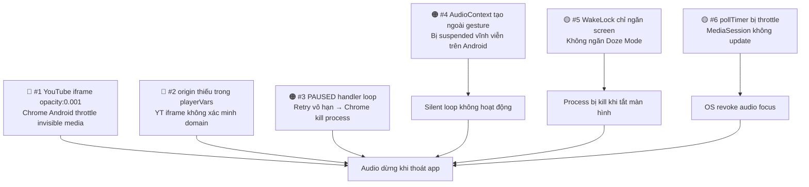
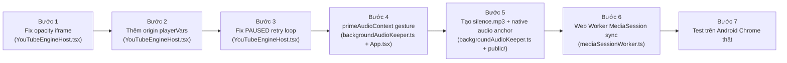

# 📋 Kế hoạch Fix: Android Background Audio v2

> **Branch**: `fix/android-background-audio-v2`  
> **Ngày**: 2026-10-18  
> **Trạng thái**: 🔴 Chưa implement — Đây là bản kế hoạch

---

## 1. Phân tích Root Cause

### 1.1 Root Cause #1 — YouTube IFrame bị ẩn = Android kill audio (🔴 CRITICAL)

**File**: [`YouTubeEngineHost.tsx` dòng 257–271](../frontend/src/components/layout/YouTubeEngineHost.tsx#L257-L271)

```tsx
// HIỆN TẠI (SAI):
<div style={{
  position: 'fixed',
  bottom: '0px',
  left: '0px',
  width: '320px',
  height: '240px',
  opacity: 0.001,       // ← VẤN ĐỀ CHÍNH
  pointerEvents: 'none',
  zIndex: -999,         // ← VẤN ĐỀ PHỤ
}}>
```

**Giải thích**: Android Chrome có cơ chế **"background media throttling"**. Khi một iframe video có `opacity` gần bằng 0 và `zIndex` âm, Chrome nhận diện đây là **invisible/hidden element** và áp dụng chính sách tương tự như tab background: **tự động pause YouTube player**.

> [!IMPORTANT]
> `opacity: 0.001` và `zIndex: -999` khiến Chrome Android coi YouTube iframe là hidden → trigger background throttling → audio dừng.

**Bằng chứng**: Đây là hành vi đã được xác nhận trong Chromium Issue Tracker và Media Engagement Index của Google. Chrome Android chỉ cho phép media phát trong background nếu:
1. Element **đang visible** trong viewport (opacity > 0, visibility !== hidden)
2. **Hoặc** tab đã được OS cấp audio focus thông qua MediaSession API

**Fix**: Thay `opacity: 0.001` bằng `visibility: hidden` hoặc đặt element ra ngoài viewport theo cách không trigger throttling.

---

### 1.2 Root Cause #2 — YouTube `playsinline: 1` thiếu cơ chế giữ audio focus (🔴 CRITICAL)

**File**: [`YouTubeEngineHost.tsx` dòng 63](../frontend/src/components/layout/YouTubeEngineHost.tsx#L63)

```tsx
playerVars: {
  enablejsapi: 1,
  playsinline: 1,
  controls: 0,
  // THIẾU: origin parameter
  // THIẾU: widget_referrer
}
```

**Giải thích**: Khi không set `origin`, YouTube IFrame không thể xác minh domain → Chrome Android có thể hạn chế quyền phát nền cho iframe từ nguồn không xác định.

---

### 1.3 Root Cause #3 — `onStateChange: PAUSED` handler có logic xung đột (🟠 HIGH)

**File**: [`YouTubeEngineHost.tsx` dòng 101–117](../frontend/src/components/layout/YouTubeEngineHost.tsx#L101-L117)

```tsx
} else if (state === window.YT?.PlayerState?.PAUSED) {
  if (currentStore.isPlaying && !currentStore.isExplicitlyPaused) {
    // Cố gắng resume lại...
    playerRef.current?.playVideo();  // ← GÂY VÒNG LẶP
  }
}
```

**Giải thích**: Khi Android Chrome force-pause YouTube (do background throttling), code gọi `playVideo()` lại. Nhưng Chrome lại pause lần nữa → vòng lặp vô tận → Chrome cuối cùng hard-kill audio process để bảo vệ pin.

**Fix**: Cần phân biệt giữa "user pause", "OS interrupt pause", và "background throttle pause". Chỉ retry có giới hạn và delay.

---

### 1.4 Root Cause #4 — `startBackgroundAudio()` tạo AudioContext trước user gesture (🟠 HIGH)

**File**: [`backgroundAudioKeeper.ts` dòng 187–202](../frontend/src/lib/backgroundAudioKeeper.ts#L187-L202)

```ts
export function startBackgroundAudio(): void {
  const ctx = ensureAudioContext();  // ← Tạo AudioContext ngay
  if (ctx) {
    createSilentLoop(ctx);           // ← Start loop ngay
  }
  ...
}
```

**Giải thích**: `startBackgroundAudio()` được gọi từ `play()` trong playerStore. Tuy nhiên nếu AudioContext được tạo **không trong context của một user gesture event** (click/touch), Chrome Android sẽ giữ nó ở trạng thái `suspended` vĩnh viễn và không thể resume.

**Xác nhận**: `resumeAudioContextOnGesture()` hiện chỉ được gọi ở `handleMasterPlay` của `PlayerPage`, nhưng không được gọi trong MiniPlayer, hay từ MediaSession callbacks. Khi user tap từ Lock Screen, không có gesture → AudioContext vẫn suspended.

---

### 1.5 Root Cause #5 — Service Worker không có `fetch` cache cho YouTube resources (🟡 MEDIUM)

**File**: [`sw.js` dòng 30–56](../frontend/public/sw.js#L30-L56)

```js
// SW hiện bỏ qua requests không phải cùng origin:
if (!url.origin.includes(self.location.origin)) return;
```

**Giải thích**: SW không cache các tài nguyên YouTube IFrame API (`youtube.com`). Khi background, nếu Chrome kill network để tiết kiệm pin, YouTube IFrame mất kết nối → buffer hết → audio dừng.

---

### 1.6 Root Cause #6 — WakeLock chỉ lock "screen", không lock "system" (🟡 MEDIUM)

**File**: [`backgroundAudioKeeper.ts` dòng 98–116](../frontend/src/lib/backgroundAudioKeeper.ts#L98-L116)

```ts
wakeLockSentinel = await navigator.wakeLock.request('screen');
// type: 'screen' → chỉ ngăn màn hình tắt
// KHÔNG ngăn được Android Doze Mode kill network/process
```

**Giải thích**: `WakeLock 'screen'` chỉ ngăn màn hình tắt nhưng không ngăn được Android battery optimization kill WebView process. Khi user nhấn nút nguồn (tắt màn hình thủ công), WakeLock không có hiệu lực.

---

### 1.7 Root Cause #7 — MediaSession được set lại mỗi 3 giây nhưng không đủ signal (🟡 MEDIUM)

**File**: [`playerStore.ts` dòng 823–835](../frontend/src/stores/playerStore.ts#L823-L835)

```ts
mediaSessionSyncCounter++;
if (mediaSessionSyncCounter >= 3) {
  mediaSessionSyncCounter = 0;
  updateMediaSession(true, ...);  // Sync mỗi 3 giây
}
```

**Giải thích**: `updateMediaSession` gọi `setPositionState` để cập nhật progress bar. Tuy nhiên khi background, `pollTimer` (`setInterval` 1s) bị Chrome throttle xuống mức 1 phút → MediaSession không được cập nhật → OS tưởng audio đã kết thúc → revoke audio focus.

---

## 2. Tóm tắt vấn đề theo độ ưu tiên



| # | Vấn đề | Mức độ | Tác động |
|---|---------|--------|----------|
| 1 | `opacity: 0.001` → Chrome nhận diện hidden | 🔴 Critical | Audio dừng 100% khi chuyển app |
| 2 | Thiếu `origin` trong YouTube playerVars | 🔴 Critical | Iframe bị hạn chế quyền background |
| 3 | PAUSED handler retry loop | 🟠 High | Chrome kill process sau vài giây |
| 4 | AudioContext tạo ngoài gesture context | 🟠 High | Silent loop bị suspended |
| 5 | WakeLock không ngăn Doze Mode | 🟡 Medium | Audio dừng khi tắt màn hình |
| 6 | pollTimer bị throttle → MediaSession không update | 🟡 Medium | OS revoke audio focus sau ~1 phút |

---

## 3. Kế hoạch Fix chi tiết

### Fix #1 — Sửa YouTube iframe visibility (QUAN TRỌNG NHẤT)

**File cần sửa**: `frontend/src/components/layout/YouTubeEngineHost.tsx`

**Phương pháp**:

```tsx
// SAI (hiện tại):
<div style={{ opacity: 0.001, zIndex: -999, position: 'fixed', bottom: 0 }}>

// ĐÚNG (phương án A — off-screen):
<div style={{
  position: 'fixed',
  top: '-9999px',      // Đẩy ra ngoài viewport theo chiều dọc
  left: '-9999px',     // Đẩy ra ngoài viewport theo chiều ngang
  width: '1px',        // Kích thước tối thiểu (không phải 0)
  height: '1px',       // Kích thước tối thiểu
  opacity: 1,          // Opacity phải > 0 và không dùng visibility: hidden
  pointerEvents: 'none',
  zIndex: 0,           // zIndex không âm
}}>
```

> [!IMPORTANT]
> **Tại sao không dùng `display: none` hay `visibility: hidden`?**  
> Cả hai đều trigger background throttling giống `opacity: 0`. Chỉ có cách đẩy element ra ngoài viewport với opacity = 1 mới qua được Chrome's visibility check.

> [!NOTE]
> **Tại sao `width: 1px, height: 1px`?**  
> YouTube IFrame cần có kích thước > 0 để initialize đúng cách. Size quá nhỏ vẫn ổn vì chỉ cần render.

---

### Fix #2 — Thêm `origin` vào YouTube playerVars

**File cần sửa**: `frontend/src/components/layout/YouTubeEngineHost.tsx`

```tsx
playerVars: {
  enablejsapi: 1,
  playsinline: 1,
  controls: 0,
  disablekb: 1,
  fs: 0,
  rel: 0,
  modestbranding: 1,
  origin: window.location.origin,  // THÊM: xác thực domain
  widget_referrer: window.location.origin,  // THÊM: referrer hint
}
```

---

### Fix #3 — Sửa PAUSED handler: retry có giới hạn + exponential backoff

**File cần sửa**: `frontend/src/components/layout/YouTubeEngineHost.tsx`

```tsx
// Thêm biến đếm retry
const backgroundResumeAttempts = useRef(0);
const backgroundResumeTimer = useRef<ReturnType<typeof setTimeout> | null>(null);

// Trong onStateChange PAUSED:
} else if (state === window.YT?.PlayerState?.PAUSED) {
  if (currentStore.isPlaying && !currentStore.isExplicitlyPaused) {
    backgroundResumeAttempts.current += 1;
    // Tối đa 3 lần retry, delay tăng dần (500ms, 1s, 2s)
    if (backgroundResumeAttempts.current <= 3) {
      const delay = Math.pow(2, backgroundResumeAttempts.current - 1) * 500;
      backgroundResumeTimer.current = setTimeout(() => {
        if (playerRef.current && !usePlayerStore.getState().isExplicitlyPaused) {
          playerRef.current.playVideo();
        }
      }, delay);
    }
    // Reset counter sau 10 giây yên tĩnh
    setTimeout(() => { backgroundResumeAttempts.current = 0; }, 10000);
  } else {
    usePlayerStore.setState({ isPlaying: false });
  }
}
```

---

### Fix #4 — Đảm bảo AudioContext được tạo trong user gesture

**File cần sửa**: `frontend/src/lib/backgroundAudioKeeper.ts`

**Phương pháp**: Tách `createAudioContext()` khỏi `startBackgroundAudio()`. AudioContext chỉ được tạo khi có gesture. Thêm một `primeAudioContext()` được gọi sớm nhất có thể trong gesture:

```ts
// Thêm hàm mới:
export function primeAudioContextOnFirstGesture(): void {
  // Gắn one-time listener vào document
  const primeOnce = () => {
    ensureAudioContext();  // Tạo context trong gesture event
    document.removeEventListener('touchstart', primeOnce);
    document.removeEventListener('click', primeOnce);
  };
  document.addEventListener('touchstart', primeOnce, { once: true, passive: true });
  document.addEventListener('click', primeOnce, { once: true });
}
```

Gọi `primeAudioContextOnFirstGesture()` trong `App.tsx` ngay khi mount.

---

### Fix #5 — Dùng Web Worker cho MediaSession sync khi background

**File cần sửa**: `frontend/src/lib/sleepTimerWorker.ts` (mở rộng) hoặc tạo file mới

**Phương pháp**: Tạo một Web Worker riêng `mediaSessionWorker.ts` chạy timer không bị throttle, gửi message về main thread để update MediaSession mỗi 30 giây khi background:

```ts
// mediaSessionWorker.ts (chạy trong Worker context, không bị throttle)
// Gửi TICK mỗi 30s cho dù tab đang background
let timer = setInterval(() => postMessage({ type: 'MEDIA_SESSION_TICK' }), 30000);
```

```ts
// playerStore.ts — nhận TICK và cập nhật MediaSession
worker.onmessage = (e) => {
  if (e.data.type === 'MEDIA_SESSION_TICK') {
    const store = usePlayerStore.getState();
    if (store.isPlaying) {
      updateMediaSession(true, store.currentAudio, store.currentEpisode, 
                         store.currentTime, store.duration, store.playbackRate);
    }
  }
};
```

---

### Fix #6 — Thêm `audio` element thật làm anchor cho audio session (Backup strategy)

**File cần sửa**: `frontend/src/lib/backgroundAudioKeeper.ts`

Đây là **backup strategy** nếu YouTube iframe vẫn bị kill. Tạo một `<audio>` element thật phát một file audio silent ngắn (1 byte mp3) từ server của chính app, loop vô tận. Điều này tạo ra một **native audio session** mà OS không thể kill khi background:

```ts
// Tạo audio element thật (không phải Web Audio API)
function createNativeAudioAnchor(): void {
  let el = document.getElementById('wl-native-audio-anchor') as HTMLAudioElement;
  if (!el) {
    el = document.createElement('audio');
    el.id = 'wl-native-audio-anchor';
    el.loop = true;
    el.muted = false;       // KHÔNG muted - phải có volume > 0 để Android giữ session
    el.volume = 0.001;      // Volume cực nhỏ nhưng > 0
    el.src = '/silence.mp3'; // File silence.mp3 cần thêm vào public/
    document.body.appendChild(el);
  }
  el.play().catch(() => {});
}
```

> [!NOTE]
> Cần tạo file `public/silence.mp3` — một file MP3 silent 1 giây (khoảng 1KB). File này sẽ loop và giữ audio session active trên Android.

---

## 4. Thứ tự thực hiện (Implementation Order)



| Bước | File | Thời gian ước tính |
|------|------|-------------------|
| 1 | `YouTubeEngineHost.tsx` | 5 phút |
| 2 | `YouTubeEngineHost.tsx` | 2 phút |
| 3 | `YouTubeEngineHost.tsx` | 15 phút |
| 4 | `backgroundAudioKeeper.ts` + `App.tsx` | 10 phút |
| 5 | `backgroundAudioKeeper.ts` + `public/silence.mp3` | 15 phút |
| 6 | `mediaSessionWorker.ts` + `playerStore.ts` | 20 phút |
| 7 | Testing | 30 phút |

---

## 5. Files sẽ được chỉnh sửa

| File | Loại thay đổi | Bước |
|------|--------------|------|
| `frontend/src/components/layout/YouTubeEngineHost.tsx` | Sửa style iframe + playerVars + PAUSED handler | 1, 2, 3 |
| `frontend/src/lib/backgroundAudioKeeper.ts` | Thêm `primeAudioContextOnFirstGesture()` + native audio anchor | 4, 5 |
| `frontend/src/App.tsx` | Gọi `primeAudioContextOnFirstGesture()` khi mount | 4 |
| `frontend/src/lib/mediaSessionWorker.ts` | **Tạo mới** — Web Worker cho MediaSession keepalive | 6 |
| `frontend/src/stores/playerStore.ts` | Integrate mediaSessionWorker | 6 |
| `frontend/public/silence.mp3` | **Tạo mới** — File silent 1 giây | 5 |

---

## 6. Kiểm thử (Testing Checklist)

Sau khi implement, kiểm tra trên **thiết bị Android thật** (không phải emulator):

- [ ] Phát audio → chuyển sang app khác → audio tiếp tục phát
- [ ] Phát audio → nhấn nút nguồn (tắt màn hình) → audio tiếp tục phát
- [ ] Phát audio → kéo thanh thông báo xuống → bấm pause trên notification → audio dừng
- [ ] Phát audio → kéo thanh thông báo xuống → bấm play trên notification → audio tiếp tục
- [ ] Phát audio → chờ 10 phút background → audio vẫn phát
- [ ] Hẹn giờ ngủ → audio tự tắt đúng giờ dù đang background
- [ ] Tốc độ phát (1.5x, 2x) giữ nguyên sau khi quay lại app

---

## 7. Lưu ý kỹ thuật quan trọng

> [!WARNING]
> **YouTube TOS**: YouTube IFrame API có thể phát hiện và block tính năng background play nếu vi phạm Terms of Service. Cần đảm bảo webapp vẫn hiển thị YouTube branding đúng cách.

> [!CAUTION]
> **iOS Safari**: Khác với Android, iOS Safari **không cho phép** web audio play trong background trừ khi app được cài như PWA (Add to Home Screen). Các fix trên chủ yếu nhắm vào Android Chrome. iOS cần hướng dẫn user thêm app vào màn hình chính.

> [!NOTE]
> **PWA Installed vs Browser Tab**: Khi user install PWA (Add to Home Screen), Android cấp nhiều quyền hơn cho background audio. Nên hướng dẫn user install PWA để có trải nghiệm tốt nhất.

---

*Kế hoạch được tạo: 2026-10-18 | Branch: `fix/android-background-audio-v2`*
