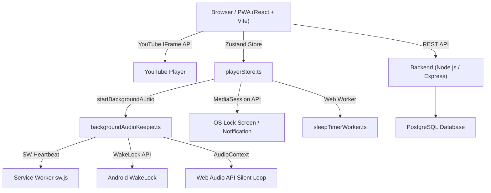
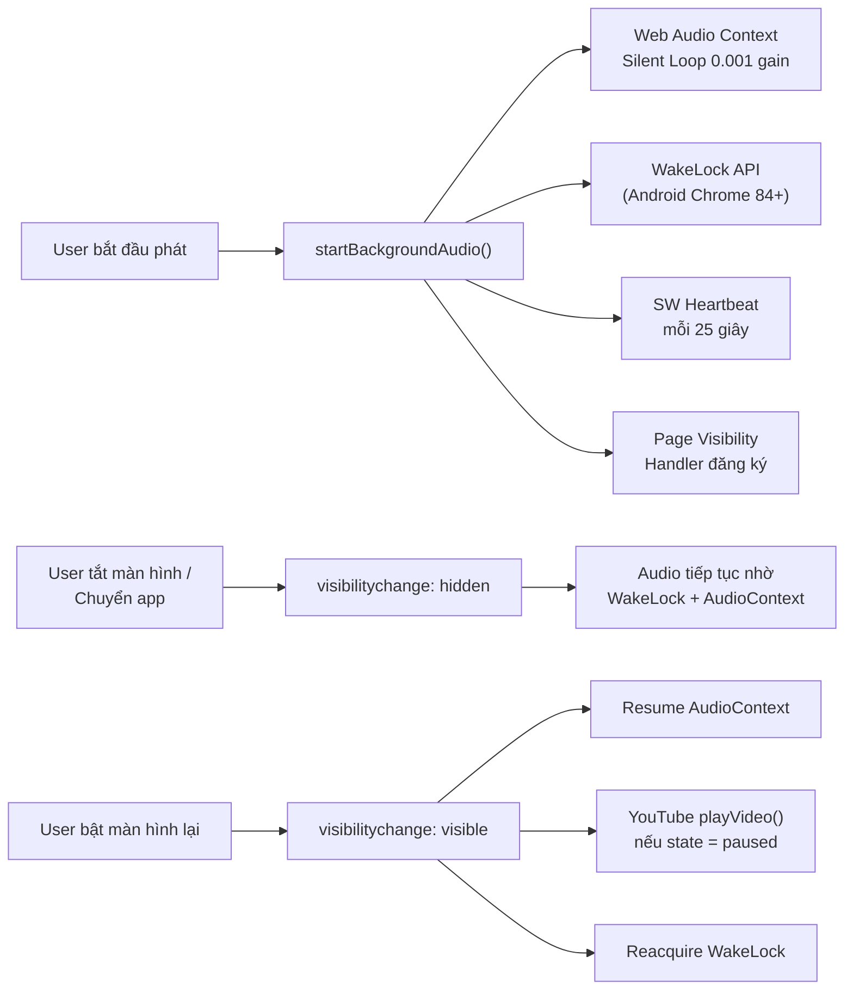
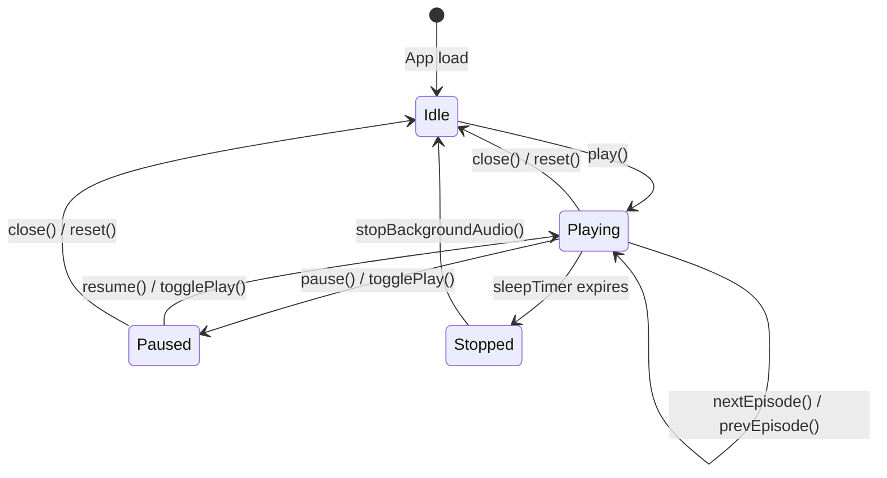
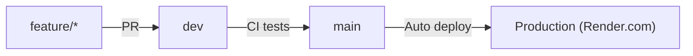

# WaveLink Audio App — Project Documentation

> **Nghe truyện audio trực tuyến. Chạy mượt. Nghe nền. Mọi nơi.**

---

## Mục lục

1. [Tổng quan dự án](#1-tổng-quan-dự-án)
2. [Kiến trúc hệ thống](#2-kiến-trúc-hệ-thống)
3. [Cấu trúc thư mục](#3-cấu-trúc-thư-mục)
4. [Tech stack](#4-tech-stack)
5. [Hướng dẫn cài đặt & chạy](#5-hướng-dẫn-cài-đặt--chạy)
6. [Background Audio — Giải pháp kỹ thuật](#6-background-audio--giải-pháp-kỹ-thuật)
7. [Player Architecture](#7-player-architecture)
8. [PWA & Service Worker](#8-pwa--service-worker)
9. [API Reference](#9-api-reference)
10. [Git Workflow & Branching](#10-git-workflow--branching)
11. [Deployment](#11-deployment)

---

## 1. Tổng quan dự án

WaveLink là webapp nghe truyện audio sử dụng YouTube làm CDN audio. Người dùng có thể:

- Nghe truyện với player tích hợp (YouTube IFrame API)
- Tiếp tục nghe từ lần trước (progress sync)
- Nghe nền khi chuyển app / tắt màn hình (đặc biệt Android)
- Hẹn giờ ngủ tự động tắt audio
- Điều khiển từ Lock Screen / Notification (MediaSession API)
- Phân quyền VIP / Free

---

## 2. Kiến trúc hệ thống



---

## 3. Cấu trúc thư mục

```
wavelink-audio-app/
├── frontend/                    # React SPA
│   ├── src/
│   │   ├── components/
│   │   │   ├── common/          # Reusable UI (LoadingState, Skeletons...)
│   │   │   ├── community/       # Community features (ShareStoryModal...)
│   │   │   ├── layout/          # App layout, nav
│   │   │   └── ui/              # Design system (Toast, Modal, Slider...)
│   │   ├── hooks/               # React Query hooks
│   │   │   └── useAudio.ts      # Audio CRUD + favorites
│   │   ├── lib/
│   │   │   ├── backgroundAudioKeeper.ts  # ⭐ Background audio engine
│   │   │   ├── playbackRateCoordinator.ts # Playback speed sync
│   │   │   ├── sleepTimerWorker.ts        # Sleep timer Web Worker
│   │   │   ├── playerLogger.ts            # Debug logging
│   │   │   └── soundEffects.ts            # UI sound effects
│   │   ├── pages/
│   │   │   ├── PlayerPage.tsx   # ⭐ Main player UI
│   │   │   ├── HomePage.tsx
│   │   │   ├── LibraryPage.tsx
│   │   │   └── ...
│   │   ├── services/
│   │   │   ├── api.ts           # Axios client wrapper
│   │   │   └── ...
│   │   ├── stores/
│   │   │   ├── playerStore.ts   # ⭐ Zustand player state + YouTube control
│   │   │   └── authStore.ts
│   │   └── types/               # TypeScript type definitions
│   ├── public/
│   │   ├── sw.js                # ⭐ Service Worker
│   │   └── manifest.json        # ⭐ PWA Manifest
│   ├── index.html               # Entry HTML với PWA metas
│   └── vite.config.ts
├── backend/                     # Node.js API server
├── docs/                        # Documentation
│   └── README.md                # (file này)
└── start/                       # Dev server scripts
```

---

## 4. Tech stack

| Layer | Technology |
|---|---|
| **Frontend** | React 18 + TypeScript + Vite |
| **State** | Zustand |
| **Data fetching** | TanStack Query (React Query) |
| **Audio source** | YouTube IFrame API |
| **Background audio** | Web Audio API + WakeLock + MediaSession |
| **PWA** | Service Worker + Web App Manifest |
| **Styling** | Tailwind CSS |
| **Backend** | Node.js + Express |
| **Database** | PostgreSQL |
| **Deployment** | Docker + Render.com |

---

## 5. Hướng dẫn cài đặt & chạy

### Prerequisites

- Node.js 18+
- pnpm hoặc npm

### Frontend

```bash
cd frontend
npm install
npm run dev         # Dev server tại http://localhost:5173
npm run build       # Production build
npm run test        # Chạy Vitest tests
```

### Backend

```bash
cd backend
npm install
npm run dev         # Dev server tại http://localhost:3000
```

### Full stack (dev)

```bash
# Windows
.\start\start.bat

# Hoặc trực tiếp
cd start && python server.py
```

---

## 6. Background Audio — Giải pháp kỹ thuật

> Đây là phần quan trọng nhất của dự án. Xem [backgroundAudioKeeper.ts](../frontend/src/lib/backgroundAudioKeeper.ts).

### Vấn đề trên Android Chrome

Khi user chuyển app hoặc tắt màn hình:

1. **AudioContext bị suspend** → silent loop dừng → OS tưởng không có audio session
2. **YouTube IFrame bị pause** bởi Chrome background tab throttling
3. **`setInterval` bị throttle** từ 1s → 60s+ → timer và progress sync mất chính xác
4. **Service Worker bị terminate** → mất keepalive

### Giải pháp đa tầng



### Chi tiết kỹ thuật từng layer

#### Layer 1: Web Audio API Silent Loop

```typescript
// Stereo buffer, gain = 0.001 (không phải 0 để tránh browser optimization)
const buffer = ctx.createBuffer(2, ctx.sampleRate * 2, ctx.sampleRate);
gainNode.gain.setValueAtTime(0.001, ctx.currentTime);
```

**Tại sao:** Browser chỉ giữ audio session active nếu có ít nhất một stream đang "phát". Silent loop với gain cực nhỏ đánh lừa OS.

#### Layer 2: Screen WakeLock

```typescript
wakeLockSentinel = await navigator.wakeLock.request('screen');
```

**Tại sao:** Ngăn Android Doze Mode kill WebView process. Tự động reacquire khi WakeLock bị release.  
**Hỗ trợ:** Android Chrome 84+, Edge 97+, Chrome Desktop. Không có trên iOS Safari.

#### Layer 3: Page Visibility + YouTube Resume Guard

```typescript
document.addEventListener('visibilitychange', () => {
  if (document.visibilityState === 'visible' && isRunning) {
    silentAudioCtx.resume();
    // playerStore cũng có guard riêng để resume YouTube:
    if (ytState === 2 || ytState === -1) ytPlayerInstance.playVideo();
  }
});
```

#### Layer 4: Service Worker Heartbeat

```typescript
// Mỗi 25 giây gửi ping để SW không bị browser terminate
registration.active.postMessage({ type: 'AUDIO_KEEPALIVE' });
```

#### Layer 5: MediaSession API (Lock Screen Control)

Đăng ký đầy đủ 8 action handlers:

| Action | UI Element | Hành động |
|---|---|---|
| `play` | Nút play notification | `resume()` |
| `pause` | Nút pause notification | `pause()` |
| `stop` | Swipe dismiss | `pause()` |
| `seekbackward` | Nút `<<` | `skipSeconds(-10)` |
| `seekforward` | Nút `>>` | `skipSeconds(+30)` |
| `previoustrack` | Nút tập trước | `prevEpisode()` |
| `nexttrack` | Nút tập tiếp | `nextEpisode()` |
| `seekto` | Drag progress bar | `seekTo(position)` |

> [!IMPORTANT]
> Nếu không đăng ký đủ action handlers, Android OS có thể không nhận diện đây là audio player và không hiển thị notification controls.

#### Layer 6: iOS Safari — User Gesture Requirement

iOS Safari yêu cầu `AudioContext.resume()` phải được gọi trong một user gesture event. Ta gọi `resumeAudioContextOnGesture()` trong `handleMasterPlay()` của PlayerPage.

### Compatibility Matrix

| Platform | Layer 1 | Layer 2 | Layer 3 | Layer 4 | Layer 5 |
|---|---|---|---|---|---|
| **Android Chrome 84+** | ✅ | ✅ | ✅ | ✅ | ✅ |
| **Android Chrome < 84** | ✅ | ❌ | ✅ | ✅ | ✅ |
| **iOS Safari (PWA)** | ✅* | ❌ | ✅ | ✅ | ✅ |
| **Desktop Chrome** | ✅ | ✅ | ✅ | ✅ | ✅ |
| **Firefox** | ✅ | ❌ | ✅ | ✅ | ⚠️ |

*iOS yêu cầu user gesture lần đầu

---

## 7. Player Architecture

### Zustand Store (`playerStore.ts`)



### YouTube Player State Lifecycle

| YT State | Giá trị | Hành động của store |
|---|---|---|
| Unstarted | -1 | Resume nếu `isPlaying` |
| Ended | 0 | `handleEpisodeComplete()` |
| **Playing** | 1 | Cập nhật `currentTime` mỗi 1s |
| **Paused** | 2 | Nếu `!isExplicitlyPaused` → resume |
| Buffering | 3 | Chờ |
| Cued | 5 | Chờ |

### Polling & Heartbeat Timers

| Timer | Interval | Mục đích |
|---|---|---|
| `pollTimer` | 1 giây | Sync `currentTime`, watchdog speed, kiểm tra sleep timer |
| `heartbeatTimer` | 60 giây | Lưu progress lên server |
| `swHeartbeatTimer` | 25 giây | Giữ Service Worker alive |

> [!NOTE]
> `pollTimer` dùng `setInterval` ở main thread. Trên Android background, Chrome throttle này xuống minimum 1 phút. Đây là lý do sleep timer dùng **Web Worker riêng** (không bị throttle).

---

## 8. PWA & Service Worker

### Service Worker (`public/sw.js`)

| Event | Xử lý |
|---|---|
| `install` | `skipWaiting()` → active ngay |
| `activate` | `clients.claim()` + xóa cache cũ |
| `fetch` | Network-first, cache static assets |
| `message: AUDIO_KEEPALIVE` | Phản hồi ACK, giữ SW alive |
| `message: SHOW_NOTIFICATION` | Hiển thị OS notification |
| `message: SKIP_WAITING` | Force update SW |
| `notificationclick` | Focus/navigate window |
| `push` | Web Push notification |

### PWA Manifest (`public/manifest.json`)

```json
{
  "display": "standalone",
  "categories": ["entertainment", "music"],
  ...
}
```

`categories: ["music"]` giúp Android nhận diện đây là audio app và ưu tiên giữ process.

### Đăng ký Service Worker

Service Worker được đăng ký qua `externalNotificationService.ts`. Đảm bảo SW được register trước khi phát audio.

---

## 9. API Reference

### Progress API

```typescript
// Cập nhật vị trí nghe
api.progress.updateProgress({
  audioId: number,
  episodeId: number,
  positionSeconds: number,
  progressPercent: number,
  completed: boolean,
});
```

### History API

```typescript
// Ghi lịch sử nghe (sau 10+ giây)
api.history.recordHistory({
  audioId: number,
  episodeId: number,
  durationListened: number,
});
```

---

## 10. Git Workflow & Branching



### Branches hiện tại

| Branch | Mục đích |
|---|---|
| `main` | Production, auto-deploy |
| `dev` | Integration branch |
| `feature/mobile-background-audio` | **[ACTIVE]** Fix background audio Android |

### Commit Convention

```
type(scope): message

feat(player): add MediaSession seekto handler
fix(background-audio): resume AudioContext on visibility change
chore(deps): update packages
docs: add background audio documentation
```

---

## 11. Deployment

### Docker

```bash
docker build -t wavelink .
docker run -p 3000:3000 wavelink
```

### Render.com

- Auto-deploy từ `main` branch
- Trigger bằng `RENDER_DEPLOY_HOOK` secret
- CI: GitHub Actions (`.github/workflows/`)

### Environment Variables

```env
DATABASE_URL=postgresql://...
JWT_SECRET=...
YOUTUBE_API_KEY=...     # Nếu dùng YouTube Data API
```

---

*Tài liệu cập nhật lần cuối: 2026-10-18 | Branch: feature/mobile-background-audio*
