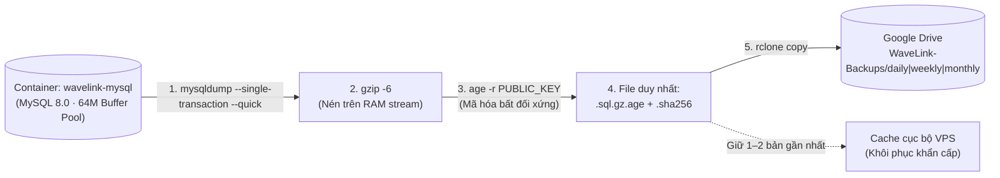

# Ý tưởng Backup Database Mã Hóa Lên Google Drive (Single-File Encrypted Backup)

> **Mục tiêu:** Đóng gói toàn bộ cơ sở dữ liệu MySQL (`audio_app`) của WaveLink thành **1 file duy nhất đã nén & mã hóa**, đẩy tự động lên **Google Drive** với mức tiêu thụ RAM **< 30MB**, **không lưu file `.sql` thô xuống ổ cứng**, và khôi phục chỉ với **1 câu lệnh**.

---

## 1. Đánh giá tính khả thi với WaveLink

Vì WaveLink áp dụng kiến trúc tách dữ liệu và luồng phát (không lưu file âm thanh vào DB), database `audio_app` trong container `wavelink-mysql` chỉ chứa dữ liệu văn bản:
- Tài khoản, phân quyền VIP (`users`)
- Danh mục truyện & tập ảo (`youtube_videos`, `episodes`, `categories`, `tags`)
- Tiến độ & lịch sử nghe (`listening_progress`, `listening_history`)
- Đơn hàng thanh toán VIP PayOS (`membership_orders`), thông báo, cộng đồng

| Tiêu chí | Thực tế trên WaveLink | Đánh giá |
| :--- | :--- | :--- |
| **Dung lượng dump thô (`.sql`)** | Thường chỉ vài MB đến vài chục MB | Rất nhẹ, đóng gói 1 file cực nhanh |
| **Sau khi nén (`gzip -6`)** | Giảm **5 – 10 lần** (10MB → ~1.5MB) | Gói Google Drive Free **15 GB** chứa được hàng năm lịch sử |
| **Tài nguyên VPS** | `deploy/mysql/my-low-memory.cnf` đặt `innodb_buffer_pool_size = 64M`, `max_connections = 35`, `disable-log-bin = 1` | Dùng streaming pipeline để không gây nghẽn RAM hay khóa bảng |
| **Bảo mật dữ liệu** | Có email người dùng, hash mật khẩu, đơn hàng PayOS, lịch sử | **Bắt buộc mã hóa đầu-cuối trước khi rời VPS** (Google Drive không đọc được nội dung) |

**Kết luận:** Hướng đi này **rất hợp lý, chi phí 0đ và đáng triển khai sớm**. Không cần giải pháp phức tạp như replication hay S3 trả phí cho quy mô hiện tại.

---

## 2. Kiến trúc Streaming Pipeline (0 File Thô Trên Đĩa)



### Vì sao phải là Streaming Pipeline?
1. **Không bao giờ ghi file `.sql` chưa mã hóa xuống đĩa VPS:** Dữ liệu đi thẳng qua Unix pipe (`mysqldump | gzip | age > file.sql.gz.age`). Nếu VPS bị xóa nhầm hoặc lộ ổ đĩa, file thô chưa từng tồn tại.
2. **An toàn cho VPS đang phục vụ người nghe & webhook PayOS:**
   - `--single-transaction`: Chụp snapshot nhất quán cho InnoDB mà **không khóa bảng (`LOCK TABLES`)**, người dùng vẫn lưu tiến độ nghe và thanh toán PayOS bình thường trong lúc backup.
   - `--quick`: Đẩy từng dòng ra stdout thay vì nạp cả bảng lớn (như `listening_history`) vào RAM của `mysqldump`.
   - `--routines --triggers --set-gtid-purged=OFF`: Giữ đủ schema và tránh lỗi GTID khi restore sang container MySQL mới (vì `my-low-memory.cnf` đã `disable-log-bin = 1`).

---

## 3. Lựa chọn Công nghệ Mã hóa & Upload

### 3.1. Công nghệ mã hóa: `age` (Khuyên dùng) vs `openssl`

| Tiêu chí | `age` (Bất đối xứng — **Khuyên dùng**) | `openssl enc -aes-256-cbc -pbkdf2` |
| :--- | :--- | :--- |
| **Cách giữ khóa trên VPS** | VPS **chỉ lưu Public Key** (`age1...`) để mã hóa | VPS phải giữ **mật khẩu đối xứng** trong file/env |
| **Nếu VPS bị chiếm quyền** | Hacker **không giải mã được** các bản backup cũ trên Drive | Hacker lấy được mật khẩu và giải mã toàn bộ backup |
| **Private Key giải mã** | Giữ offline tại máy cá nhân / Password Manager | Dùng chung 1 mật khẩu |
| **Cài đặt trên Ubuntu** | `sudo apt install age` (nhẹ, không phụ thuộc) | Có sẵn |

> **Khuyến nghị:** Dùng **`age`**. Trên VPS chỉ đặt khóa công khai; khi cần khôi phục mới đưa khóa bí mật (`AGE-SECRET-KEY-...`) vào để giải mã.

### 3.2. Công cụ đẩy lên Google Drive: 2 phương án

| Phương án | Cách hoạt động | Ưu điểm | Nhược điểm |
| :--- | :--- | :--- | :--- |
| **A. `rclone` + `cron` / Docker profile `backup` (Khuyên dùng)** | Script bash chạy theo lịch hoặc container phụ trong `docker-compose.yml` | ~0 dòng code tự viết; hỗ trợ retry, giới hạn băng thông, tự xóa bản cũ | Cần xác thực OAuth 1 lần khi cài |
| **B. Go CLI `backend/cmd/backup/main.go`** | Viết thêm binary thứ 4 (cùng mẫu `cmd/api`, `cmd/seed`, `cmd/stream`) dùng Google Drive API + `golang.org/x/crypto` | Bấm nút **"Backup ngay"** được từ trang Admin UI; đồng nhất hệ sinh thái Go | Thêm code bảo trì & thư viện Google SDK vào `go.mod` |

**Chiến lược đề xuất:** Bắt đầu bằng **Phương án A** (`rclone` + `age`) để chạy ổn định trong 1–2 giờ; sau này nếu muốn nút "Sao lưu ngay" trên Admin Dashboard mới mở rộng sang **Phương án B**.

---

## 4. Chiến lược Lưu trữ (GFS Retention) & Đặt tên

### Quy tắc đặt tên file
Mỗi lần backup tạo đúng 1 cặp file:
- `wavelink_audio_app_2026-11-25_030000.sql.gz.age` (dữ liệu đã nén & mã hóa)
- `wavelink_audio_app_2026-11-25_030000.sql.gz.age.sha256` (checksum kiểm tra toàn vẹn trước khi khôi phục)

### Vòng đời giữ bản sao (Grandfather-Father-Son)
| Nhóm | Thư mục trên Google Drive | Tần suất | Thời gian giữ |
| :--- | :--- | :--- | :--- |
| **Daily** | `WaveLink-Backups/daily/` | Hằng ngày lúc **03:00 sáng** (giờ ít người nghe) | **7 ngày** (`--min-age 7d`) |
| **Weekly** | `WaveLink-Backups/weekly/` | Chủ nhật hằng tuần | **4 tuần** (`--min-age 28d`) |
| **Monthly** | `WaveLink-Backups/monthly/` | Ngày 01 hằng tháng | **6 tháng** (`--min-age 180d`) |
| **Local Cache (VPS)** | `/var/backups/wavelink/` | Giữ lại **2 bản `.age` gần nhất** | Giúp restore nhanh không cần tải từ Drive |

---

## 5. Mẫu Script Backup & Restore (Chạy trực tiếp với `wavelink-mysql`)

### 5.1. Tạo cặp khóa `age` (chạy 1 lần trên máy cá nhân)
```bash
age-keygen -o wavelink-backup-key.txt
# In ra dòng public key dạng: # public key: age1xxxxxxxxxxxxxxxxxxxx
# -> Chỉ copy chuỗi age1... lên VPS.
# -> File wavelink-backup-key.txt cất vào Password Manager (Bitwarden/1Password) + USB dự phòng!
```

### 5.2. Script Backup tự động (`/opt/wavelink/scripts/backup-db.sh`)
```bash
#!/usr/bin/env bash
set -euo pipefail

# Cấu hình
CONTAINER_NAME="wavelink-mysql"
DB_NAME="${MYSQL_DATABASE:-audio_app}"
DB_USER="root"
DB_PASS="${MYSQL_ROOT_PASSWORD:?Thiếu MYSQL_ROOT_PASSWORD}"
AGE_PUBLIC_KEY="${AGE_PUBLIC_KEY:?Thiếu AGE_PUBLIC_KEY}"
BACKUP_DIR="/var/backups/wavelink"
GDRIVE_REMOTE="gdrive:WaveLink-Backups"
TIMESTAMP="$(date +%Y-%m-%d_%H%M%S)"
OUT_FILE="${BACKUP_DIR}/wavelink_${DB_NAME}_${TIMESTAMP}.sql.gz.age"

mkdir -p "${BACKUP_DIR}"
chmod 700 "${BACKUP_DIR}"

# 1. Streaming Dump -> Gzip -> Age (không tạo file .sql thô trên đĩa)
# Lưu ý: truyền mật khẩu qua MYSQL_PWD trong env container để tránh lộ trong `ps aux`
docker exec -e MYSQL_PWD="${DB_PASS}" "${CONTAINER_NAME}" \
  mysqldump -u "${DB_USER}" \
    --single-transaction \
    --quick \
    --routines \
    --triggers \
    --set-gtid-purged=OFF \
    "${DB_NAME}" \
  | gzip -6 \
  | age -r "${AGE_PUBLIC_KEY}" -o "${OUT_FILE}"

# 2. Kiểm tra kích thước tối thiểu (> 1KB) & tạo checksum SHA256
if [ ! -s "${OUT_FILE}" ] || [ "$(wc -c < "${OUT_FILE}")" -lt 1024 ]; then
  echo "ERROR: File backup rỗng hoặc quá nhỏ: ${OUT_FILE}" >&2
  rm -f "${OUT_FILE}"
  exit 1
fi
sha256sum "${OUT_FILE}" > "${OUT_FILE}.sha256"

# 3. Upload lên Google Drive (phân tầng Daily / Weekly / Monthly)
rclone copy "${OUT_FILE}" "${GDRIVE_REMOTE}/daily/" --retries 3 --low-level-retries 5
rclone copy "${OUT_FILE}.sha256" "${GDRIVE_REMOTE}/daily/" --retries 3

if [ "$(date +%u)" -eq 7 ]; then
  rclone copy "${OUT_FILE}" "${GDRIVE_REMOTE}/weekly/" --retries 3
fi
if [ "$(date +%d)" -eq 01 ]; then
  rclone copy "${OUT_FILE}" "${GDRIVE_REMOTE}/monthly/" --retries 3
fi

# 4. Dọn bản cũ trên Google Drive & giữ 2 bản mới nhất trên VPS
rclone delete "${GDRIVE_REMOTE}/daily/" --min-age 7d
rclone delete "${GDRIVE_REMOTE}/weekly/" --min-age 28d
rclone delete "${GDRIVE_REMOTE}/monthly/" --min-age 180d

ls -1t "${BACKUP_DIR}"/*.sql.gz.age 2>/dev/null | tail -n +3 | while read -r old; do
  rm -f "${old}" "${old}.sha256"
done

echo "Backup thành công: ${OUT_FILE} ($(du -h "${OUT_FILE}" | cut -f1))"
```

> **Gắn cảnh báo (Alerting):** Nên bọc lời gọi script bằng webhook Telegram/Discord khi có lỗi (`trap 'notify_fail' ERR`) để biết ngay nếu backup thất bại do hết dung lượng hoặc token Drive hết hạn.

### 5.3. Quy trình Khôi phục (1 câu lệnh)
```bash
# 1. Tải bản cần khôi phục từ Google Drive (nếu không lấy từ /var/backups/wavelink/)
rclone copy "gdrive:WaveLink-Backups/daily/wavelink_audio_app_2026-11-25_030000.sql.gz.age" ./
rclone copy "gdrive:WaveLink-Backups/daily/wavelink_audio_app_2026-11-25_030000.sql.gz.age.sha256" ./

# 2. Kiểm tra toàn vẹn file
sha256sum -c wavelink_audio_app_2026-11-25_030000.sql.gz.age.sha256

# 3. Giải mã -> Giải nén -> Nạp thẳng vào wavelink-mysql (không chạm đĩa)
age -d -i wavelink-backup-key.txt wavelink_audio_app_2026-11-25_030000.sql.gz.age \
  | gunzip \
  | docker exec -i -e MYSQL_PWD="${MYSQL_ROOT_PASSWORD}" wavelink-mysql \
      mysql -u root audio_app
```

---

## 6. Rủi ro & Bẫy thực tế cần tránh

| Rủi ro | Nguyên nhân | Cách phòng tránh |
| :--- | :--- | :--- |
| **Token Google Drive hết hạn sau 7 ngày** | Tạo OAuth App trên Google Cloud Console ở trạng thái **"Testing"** khiến Refresh Token tự hủy sau 7 ngày | Chuyển OAuth App sang **"In Production"** (dùng cá nhân không cần Google duyệt phức tạp, chỉ bấm "Advanced → Continue" 1 lần khi `rclone config`), hoặc dùng **Service Account** với Google Shared Drive |
| **Mất Private Key `age` = mất toàn bộ backup** | Dữ liệu mã hóa đầu-cuối không thể khôi phục nếu mất khóa giải mã | Lưu `wavelink-backup-key.txt` ở tối thiểu **2 nơi độc lập ngoại tuyến** (Password Manager + USB/giấy cất giữ) |
| **Backup xong nhưng khi sự cố lại không restore được** | Lỗi schema, thiếu quyền, sai charset `utf8mb4` không phát hiện sớm | Chạy **Restore Drill mỗi tháng 1 lần**: dựng 1 container MySQL tạm, giải mã bản mới nhất nạp vào và kiểm tra `SELECT COUNT(*) FROM users / youtube_videos / membership_orders` |
| **Quên sao lưu cấu hình bí mật `env.vps`** | Backup DB có dữ liệu nhưng mất `JWT_SECRET`, `STREAM_TOKEN_SECRET`, khóa `PAYOS_*` thì hệ thống không chạy lại được | Lưu bản mã hóa `env.vps.age` cùng nơi hoặc lưu trực tiếp các biến này vào Password Manager (**không** đẩy lên Git) |
| **Bảng `listening_history` phình to sau nhiều tháng** | Mỗi lần tua/nghe sinh thêm dòng lịch sử | Bật `gzip -6` giảm dung lượng >85%; có thể thêm job định kỳ gộp hoặc dọn bản ghi lịch sử quá cũ của tài khoản Guest |

---

## 7. Triển khai thực tế trên HomeServer (`homeserver310306`)

Trên máy chủ cá nhân `homeserver310306`, MySQL 8.0 chạy trực tiếp trên Ubuntu host (`127.0.0.1:3306`, DB `audio_app`), không qua container `wavelink-mysql`. Dự án đã chuẩn bị sẵn:
- Script backup & restore không chứa bí mật: [backup-db-gdrive.sh](file:///F:/Build/wavelink-audio-app/deploy/scripts/backup-db-gdrive.sh) và [restore-db-gdrive.sh](file:///F:/Build/wavelink-audio-app/deploy/scripts/restore-db-gdrive.sh).
- Kho khóa bí mật trên máy cá nhân (đã chặn hoàn toàn trong `.gitignore`): `.secrets/gdrive-backup/` (chứa Private Key `age`, file `client_secret_desktopapp.json`, bản sao `rclone.conf` và script `authorize-gdrive.ps1`).
- Trên HomeServer chỉ lưu Public Key `age1...` trong `/home/stephen/wavelink-audio-app/env.backup` (`chmod 600`).

### Các bước kích hoạt:
1. Mở PowerShell tại thư mục dự án và chạy `.\.secrets\gdrive-backup\authorize-gdrive.ps1` để đăng nhập Google 1 lần qua trình duyệt.
2. Script tự động đẩy `~/.config/rclone/rclone.conf` lên HomeServer, chạy backup mã hóa lần đầu lên `gdrive:WaveLink-Backups/daily/`, và cài cron `0 3 * * *`.
